# KLServeLink — On-Demand Service Marketplace & Scheduled AI Platform

[](https://flutter.dev)
[](https://dart.dev)
[](https://www.typescriptlang.org)
[](https://firebase.google.com/docs/functions)
[](https://firebase.google.com/docs/firestore)
[](https://www.python.org)
[](https://fastapi.tiangolo.com)
[](https://cloud.google.com/run)
[](https://www.docker.com)
[](https://facebook.github.io/prophet/)

> **Academic Final Year Project (2025–2026):** Developed by **Lee Kai Yi** for the Bachelor of Software Engineering (Honours) at Tunku Abdul Rahman University of Management and Technology (TAR UMT). Demonstrates end-to-end full-stack systems engineering across mobile clients, serverless transactions, and containerized cloud machine learning microservices.

> [!NOTE]
> **Portfolio Showcase & Deployment Status:**  
> **KLServeLink** is a completed academic Final Year Project published as a public software engineering portfolio showcase. While the application was fully engineered, integrated, and evaluated with live Firebase and Google Cloud Platform services during academic assessment, the original live cloud infrastructure has been **decommissioned to eliminate ongoing personal cloud hosting costs**.
> 
> * **Source Code & Architecture:** The complete Flutter/Dart mobile client, TypeScript Firebase Cloud Functions, containerized Python AI microservice, and curated application screenshots are preserved for technical assessment and architectural review.
> * **Self-Hosted Execution:** Live execution of cloud-dependent features (authentication, Firestore streams, Cloud Functions, and batch ML jobs) requires configuring an independent Firebase/GCP environment using the provided templates (`.env.example`, `android/app/google-services.json.example`, `lib/firebase_options.dart.example`).
> * **Demonstration Notice:** This repository is presented strictly for technical evaluation, code review, and academic demonstration. It is not maintained as an active commercial marketplace or ongoing live service.

---

## 📌 Overview & Core Achievements

**KLServeLink** is a full-stack on-demand service marketplace designed to connect service seekers with local freelance providers across the Klang Valley (Kuala Lumpur & Selangor, Malaysia). The platform tackles critical transactional challenges in home-service marketplaces: client-side pricing tampering, booking race conditions (double-booking), opaque recommendations, and demand uncertainty for freelance providers.

### 🏆 3 Standout Engineering Achievements

1. **Server-Authoritative Pricing & Concurrency-Safe Slot Locking:**
   Engineered zero-trust TypeScript Cloud Functions (`createBookingVerified`) that independently recalculate floor pricing, billable hours, Haversine travel distance, and priority-based exclusive rule groups, overriding client-side data. Concurrency collisions are prevented by reserving 5-minute granular document locks (`timeSlotLocks`) inside atomic Firestore transactions.
2. **Decoupled Scheduled AI Batch Microservice on Cloud Run:**
   Containerized a Python 3.11 / FastAPI service deployed to Google Cloud Run, triggered asynchronously by Cloud Scheduler. It isolates heavy scientific computation (`Prophet`, `cmdstan`, `scikit-learn`, `pandas`) from mobile and transactional runtimes, precomputing recommendation matrices, empirical Bayes demand forecasts, and review sentiment directly into Firestore.
3. **Multi-Navigator Dual-Role Flutter Client with Rich I/O:**
   Architected a dual-role (Seeker/Provider) Flutter mobile app. The Provider shell manages 6 independent nested `Navigator` stacks using custom `NavigatorObserver` instances to preserve tab navigation history. Features Google Maps spatial filtering, in-app vector PDF invoice rendering (`pdf`/`printing`), and real-time multimedia chat with custom AAC-LC voice note recording and playback (`record`, `just_audio`).

---

## 📸 Platform Preview

| Seeker Discovery & Recommendations | Transparent Explainable AI (XAI) | Provider AI Demand Forecasting |
| :---: | :---: | :---: |
| 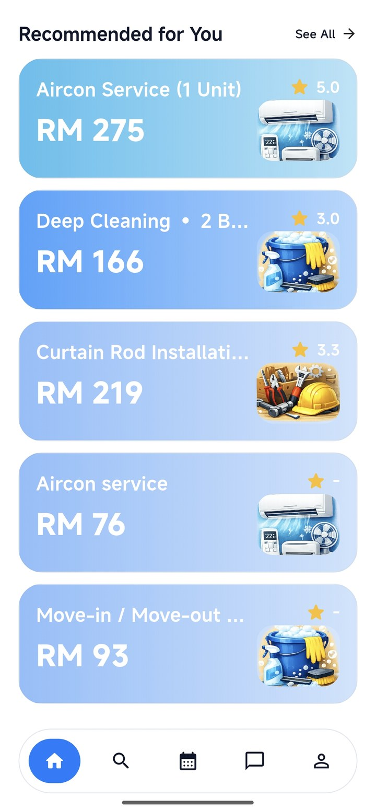 | 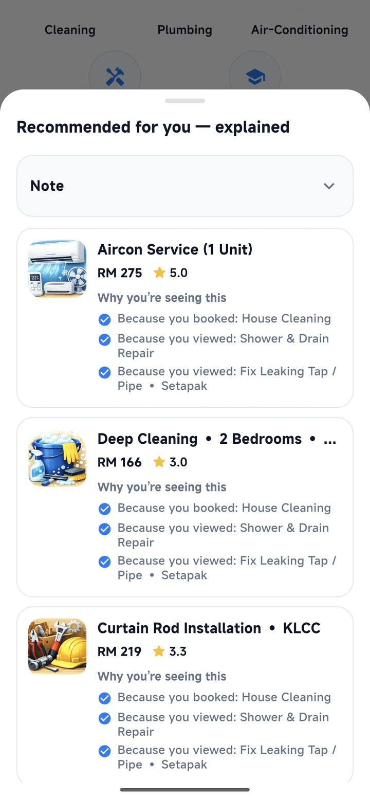 | 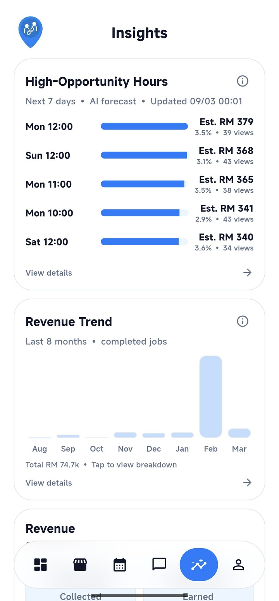 |
| *Personalized feed with category pills and dynamic pricing preview.* | *Human-readable justifications explaining why services are recommended.* | *High-Opportunity Hours & revenue predictions from scheduled batch models.* |

---

## 🏛️ System Architecture & Data Flow

KLServeLink employs a decoupled, event-driven serverless architecture that separates high-frequency user interactions from transactional validation and resource-intensive batch machine learning.

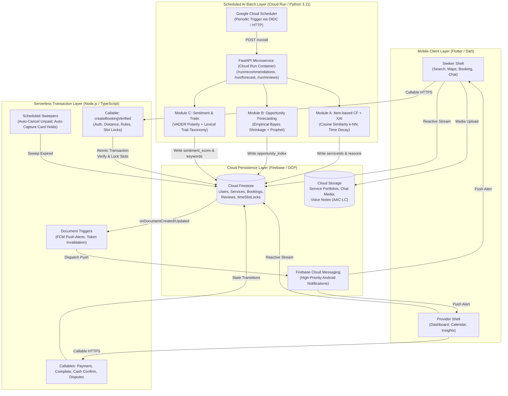

---

## 📱 Visual Walkthrough & Full Screenshot Gallery

All 12 showcase screenshots represent actual application flows captured from physical Android test devices. Status bar clutter and personal test data have been cleanly sanitized.

### Seeker Workflow

| 1. Onboarding & Splash | 2. Home & Recommendations | 3. Explainable AI (XAI) |
| :---: | :---: | :---: |
|  |  |  |
| *Hero splash introducing local on-demand service exploration in KL.* | *Horizontal carousel displaying personalized recommendations & categories.* | *Transparent modal explaining recommendation causes (history, tags, geo).* |

| 4. Interactive Map Search | 5. Service Details Screen | 6. Booking & Slot Selection |
| :---: | :---: | :---: |
| 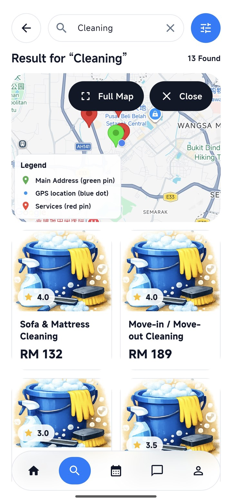 | 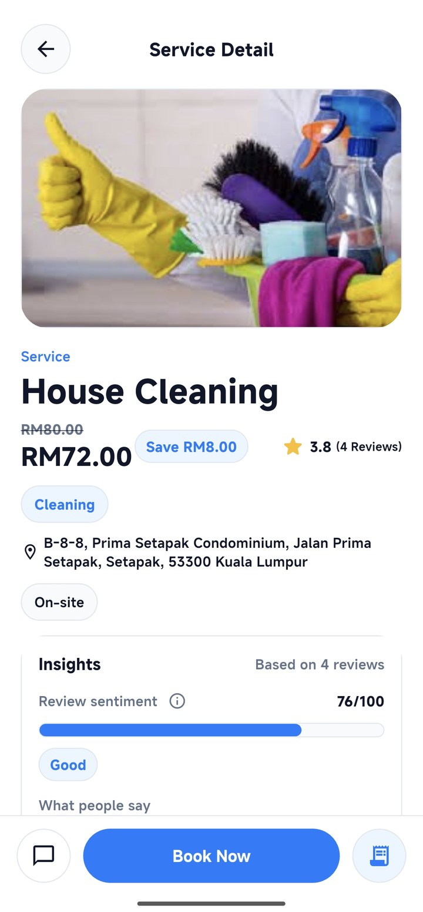 | 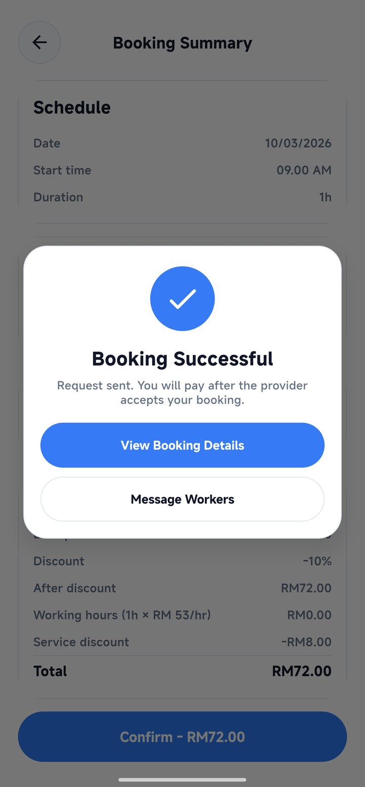 |
| *Google Maps SDK with custom markers, radius filters, and list view.* | *Detailed service specs, photo gallery, floor pricing, and reviews.* | *Interactive calendar & 5-minute interval scheduling with lock checks.* |

| 7. In-App E-Receipt (PDF) | 8. Multimedia Chat & Voice Notes |
| :---: | :---: |
| 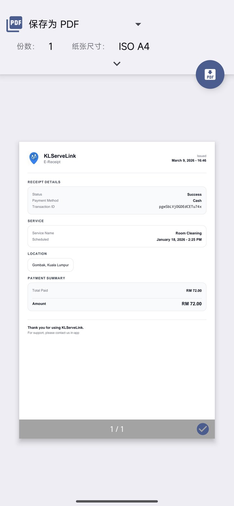 | 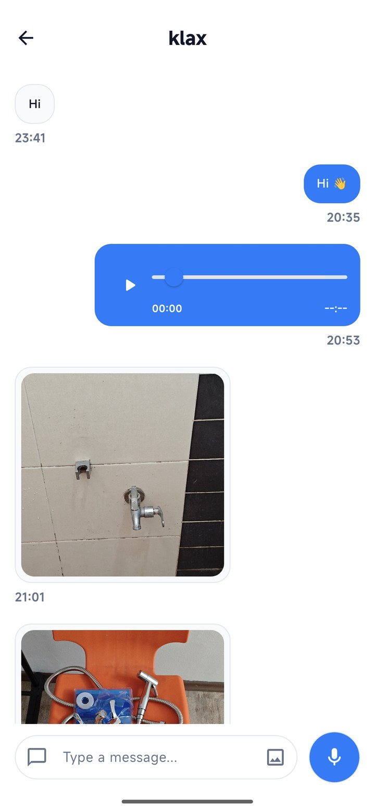 |
| *Vector-generated PDF invoice preview via `pdf` and `printing` packages.* | *Real-time chat with photo sharing and in-app AAC-LC voice note recording/playback.* |

---

### Provider Workflow

| 9. Business Dashboard | 10. Dynamic Pricing Editor | 11. AI Opportunity Forecast | 12. Review Analytics & Traits |
| :---: | :---: | :---: | :---: |
| 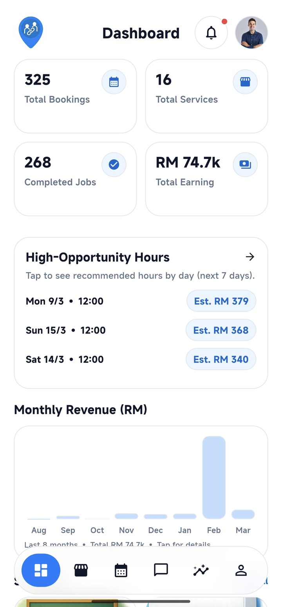 | 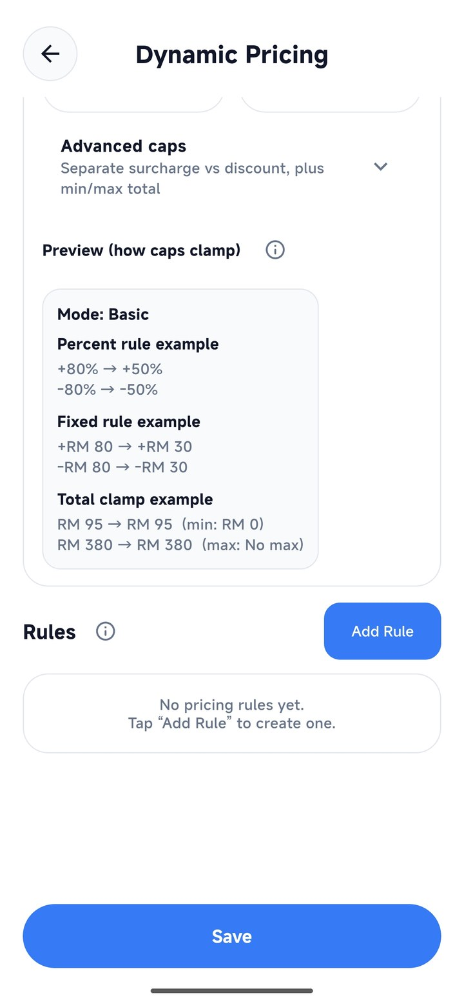 |  | 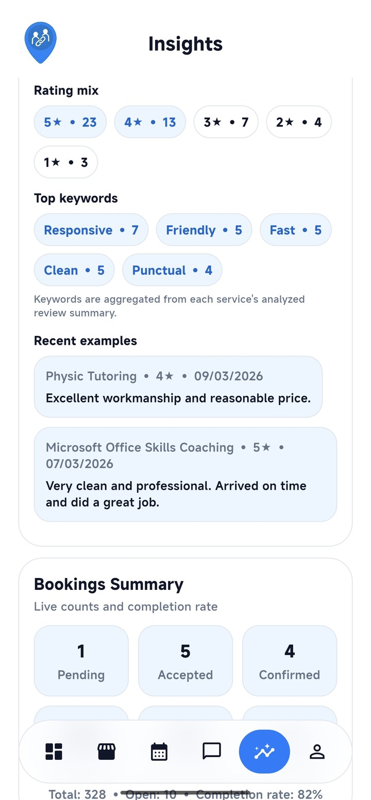 |
| *Executive KPI metrics: Total Bookings, Completed Jobs, and Revenue trends.* | *Rule builder: Day/time matchers, lead time, distance thresholds, priority caps.* | *7-day Prophet forecast highlighting High-Opportunity Hours and estimated RM.* | *Star distribution and canonical trait badges extracted via VADER NLP.* |

---

## ⚙️ Technical Deep Dives

### 1. Server-Authoritative Dynamic Pricing Engine
To prevent client-side price tampering, all pricing calculations occur on the server within `functions/src/pricing.ts` and `functions/src/index.ts`.

* **Base Floor & Billable Hours:** Services define an included duration ($h_{\text{inc}}$) and package base price ($P_{\text{base}}$). Additional hours beyond $h_{\text{inc}}$ are billed at an hourly rate ($R_{\text{hr}}$):
  $$\text{Base} = P_{\text{base}} + \max(0, h_{\text{total}} - h_{\text{inc}}) \times R_{\text{hr}}$$
* **Contextual Matching:** Rules match dynamically on day-of-week (including overnight windows such as 22:00–06:00), Haversine spatial distance between seeker and provider coordinates, minimum advance lead hours, and optional date spans.
* **Exclusive Group Conflict Resolution:** Rules belonging to the same `exclusiveGroup` (e.g. "time", "distance", "holiday") are sorted by priority and absolute value, ensuring only the dominant rule applies.
* **Configurable Boundary Caps:** Separate caps clamp percentage surcharges/discounts (`maxSurchargePercent`, `maxDiscountPercent`) and fixed amounts (`maxSurchargeFixed`, `maxDiscountFixed`), bounding final charges within defined min/max totals.

### 2. Transactional Concurrency Control (Atomic Slot Locks)
To eliminate booking collision race conditions without heavy relational locking systems:
1. When a booking request is validated in `createBookingVerified`, the server segments the duration into **5-minute discrete time chunks**.
2. For each chunk, a deterministic document reference is constructed under:
   ```
   timeSlotLocks/${providerId}_${dayKey}/slots/${slotId}
   ```
   *(where `slotId` represents padded minutes since midnight, e.g. "0540" for 09:00 AM).*
3. Inside an atomic `admin.firestore().runTransaction`, the function attempts `tx.create(ref, ...)` for each slot.
4. If **any** single 5-minute slot document already exists, Firestore aborts the transaction immediately with `ALREADY_EXISTS`, rejecting the overlapping booking.
5. If a booking is cancelled or declined, Cloud Function event triggers automatically batch-delete the corresponding slot lock documents.

### 3. Decoupled AI Batch Processing (Cloud Run & Python 3.11)
Compute-heavy statistical libraries require significant memory and native C++ compilers (`cmdstan` for Bayesian modeling). Running these in mobile clients or serverless functions introduces severe cold starts. KLServeLink isolates these in a standalone Docker microservice (`klservelink_ai_batch/Dockerfile`):

* **Item-Based Collaborative Filtering (k-NN):**
  - Builds interaction matrices from confirmed bookings (weight 3.0) and service views (weight 0.25).
  - Applies exponential half-life time decay ($t_{1/2} = 30$ days) to prioritize recent interactions:
    $$w(t) = \exp\left(-\frac{\ln(2) \times \text{age\_days}}{30}\right)$$
  - Computes cosine similarity across services for $k=40$ nearest neighbors.
  - Generates top 3 human-readable explanation justifications (*"Because you booked / viewed X"*) stored directly in the recommendation document.
  - Multi-tier cold-start fallback ladder: Category views $\rightarrow$ Recent search terms $\rightarrow$ 8km/20km Haversine radius filter $\rightarrow$ Popularity & rating score.
* **Provider Demand Forecasting & Shrinkage:**
  - Aggregates historical bookings onto a continuous hourly grid.
  - Applies **Empirical Bayes Shrinkage** to balance sparse individual provider history ($n$) against aggregate marketplace demand patterns:
    $$w_{\text{provider}} = \frac{n}{n + 15}$$
  - When sufficient provider interaction history exists ($n \ge 20$), fits an additive **Prophet** model incorporating weekly and daily seasonalities.
  - Outputs `opportunity_index.slots` with expected booking probability and estimated RM revenue, classified into in-working-hours and out-of-working-hours opportunity sets.
* **Review Sentiment & Trait Taxonomy Pipeline:**
  - Analyzes service reviews by blending VADER compound polarity (70%) with 5-star normalized scores (30%).
  - Tokenizes review text into canonical service trait chips (*"Punctual"*, *"Professional"*, *"Affordable"*, *"Clean"*, *"Responsive"*), filtering generic filler stopwords and mapping multi-word phrases.

---

## 📂 Repository Directory Layout

```
KLServeLink/
├── android/                         # Android native project files & Gradle configuration
├── assets/                          # App assets (images, onboarding graphics, category icons)
├── docs/
│   └── screenshots/                 # Curated, anonymized 720x1550 application showcase screenshots
├── functions/                       # Firebase Cloud Functions v2 (TypeScript)
│   ├── src/
│   │   ├── index.ts                 # Verified booking callables, triggers, crons & notifications
│   │   └── pricing.ts               # Server-side dynamic pricing calculation & rule engine
│   ├── package.json
│   └── tsconfig.json
├── klservelink_ai_batch/            # Containerized Python AI batch microservice (Cloud Run)
│   ├── app/
│   │   ├── main.py                  # FastAPI application & HTTP batch triggers
│   │   ├── recommend.py             # Item-based CF (k-NN), time decay, cold-start & XAI
│   │   ├── forecast.py              # Empirical Bayes shrinkage & Prophet demand forecasting
│   │   ├── arima_baseline.py        # Offline SARIMAX benchmark baseline
│   │   ├── reviews.py               # VADER sentiment analysis & trait keyword taxonomy
│   │   └── jobs.py                  # Batch orchestration pipelines
│   ├── tools/
│   │   └── evaluate_prophet_vs_arima.py # Benchmark evaluation tool (MAE/RMSE/sMAPE/WAPE)
│   ├── Dockerfile                   # Python 3.11-slim container with CmdStan compilation
│   └── requirements.txt
├── lib/                             # Flutter/Dart cross-platform application source
│   ├── app/                         # App shells, role routing (SeekerShell, ProviderShell)
│   ├── core/                        # Shared models, widgets, theme, and utility services
│   └── features/
│       ├── auth/                    # Auth gate, login, registration, role selection
│       ├── chat/                    # Real-time messaging, AAC-LC audio recorder & image viewer
│       ├── notifications/           # FCM messaging listener & local notifications handler
│       ├── pricing/                 # Dynamic pricing rules validator & provider editor UI
│       ├── provider/                # Provider dashboard, bookings calendar, profile, insights
│       ├── reviews/                 # Leave review form, rating aggregates, trait badges
│       ├── seeker/                  # Search, Google Maps, booking checkout, profile
│       └── user/                    # User models & Firestore data repositories
├── seed_tools/                      # Synthetic data generation and demo seeding tools
│   ├── seed_firestore.py            # Generates realistic users, bookings, and reviews
│   ├── seed_services.py             # Creates standardized category service documents
│   └── delete_seed.py               # Safely purges synthetic data via manifest tags
├── .env.example                     # Environment template for local microservice runs
├── analysis_options.yaml            # Dart static analysis configuration
├── firebase.json                    # Firebase deployment configuration
└── pubspec.yaml                     # Flutter package dependencies & asset manifests
```

---

## 🛠️ Local Development & Configuration Setup

> [!NOTE]
> **Portfolio Evaluation vs. Self-Hosted Execution:**  
> Prospective employers and technical reviewers can thoroughly evaluate the system design, code quality, mathematical models, and UI flows directly from this repository and the [visual screenshot gallery](#-visual-walkthrough--full-screenshot-gallery) without deploying cloud services.  
> If you wish to compile the Flutter client or run the backend services locally, follow the instructions below using your own Firebase/GCP project credentials (reference configuration templates are provided).

> [!IMPORTANT]
> **Configuration Safety:** Do not overwrite existing configuration files (`lib/firebase_options.dart` or `android/app/google-services.json`) if they are already present in your local workspace. Template files (`.env.example`, `google-services.json.example`, `firebase_options.dart.example`) are provided for fresh environments.

### Prerequisites
* **Flutter SDK:** Version `3.9.0` or higher
* **Dart SDK:** Version `3.9.0` or higher
* **Node.js:** Version `20.x` or higher & npm
* **Python:** Version `3.11.x`
* **Docker:** Recommended for running the AI batch service locally
* **Firebase Account & CLI:** For Cloud Firestore and Cloud Functions emulation

### 1. Flutter Mobile Client Setup
```bash
# Clone the repository
git clone https://github.com/KAIYI7/KLServeLink.git
cd KLServeLink

# Install Dart/Flutter dependencies
flutter pub get

# Setup Firebase configuration:
# Only copy example files if setting up a fresh project from scratch:
# cp lib/firebase_options.dart.example lib/firebase_options.dart
# cp android/app/google-services.json.example android/app/google-services.json

# Run the Flutter application on an Android device or emulator
flutter run
```

### 2. Firebase Cloud Functions Setup
```bash
cd functions

# Install Node dependencies
npm install

# Build TypeScript to JavaScript
npm run build

# Emulate Cloud Functions locally
npm run serve
```

### 3. Python AI Batch Microservice Setup
#### Option A: Running with Docker (Recommended)
```bash
cd klservelink_ai_batch

# Build the container
docker build -t klservelink-ai .

# Run the container locally
docker run -p 8080:8080 \
  -e GOOGLE_APPLICATION_CREDENTIALS=/app/service-account.json \
  -v /path/to/service-account.json:/app/service-account.json:ro \
  klservelink-ai
```

#### Option B: Running Locally with Virtualenv
```bash
cd klservelink_ai_batch

python -m venv .venv
source .venv/bin/activate  # On Windows: .venv\Scripts\activate
pip install -r requirements.txt

# Install CmdStan (required for Prophet)
python -c "from cmdstanpy import install_cmdstan; install_cmdstan(cores=2)"

# Start the FastAPI server
uvicorn app.main:app --host 0.0.0.0 --port 8080 --reload
```

---

## 🧪 Quality Assurance & Evaluation Methodology

### Documented Module Functional Test Cases
During development and evaluation, **115 distinct black-box module functional test cases** were designed, executed, and recorded across 7 functional sub-systems:

| Test Module | Documented Cases | Core Focus & Verification Boundaries |
| :--- | :---: | :--- |
| **Search & Discovery** | 18 | Keyword matching, category filtering, radius bounding, sorting |
| **Dynamic Pricing** | 12 | Exclusive group resolution, cap clamping, lead-time checks, overnight time spans |
| **Demand Prediction** | 16 | History shrinkage calculation, Prophet fit convergence, fallback triggers |
| **Feedback & Sentiment** | 11 | VADER polarity score blending, trait extraction, stopword filtering |
| **Booking & Messaging** | 28 | 5-minute atomic slot locks, status lifecycle transitions, dispute resolutions |
| **Location & Maps** | 10 | Haversine distance accuracy, GPS fallback, camera target updates |
| **Auth & User Management**| 20 | Role routing, session persistence, profile creation, unauthorized write guards |
| **Total Test Cases** | **115** | Documented functional matrix covering positive, negative, and boundary scenarios |

*Note on Testing:* The 115 test cases cited above represent documented black-box test matrices executed during academic evaluation. They are manual functional and integration verification scenarios, not automated CI/CD unit tests.

### Comparative Time-Series Model Benchmarking
An automated evaluation tool (`klservelink_ai_batch/tools/evaluate_prophet_vs_arima.py`) was implemented to benchmark time-series forecasting candidates against historical booking series:
* **Implemented Models:**
  - **Prophet:** Additive daily and weekly seasonality model blended with empirical Bayes shrinkage.
  - **SARIMAX $(1,0,1)(1,0,1)_{24}$:** Autoregressive seasonal baseline implemented in `arima_baseline.py`.
* **Computed Metrics:** MAE (Mean Absolute Error), RMSE (Root Mean Square Error), sMAPE (Symmetric Mean Absolute Percentage Error), and WAPE (Weighted Absolute Percentage Error).
* **Engineering Takeaway:** Both modeling pipelines are preserved in source code. Prophet serves as the scheduled primary model due to its handling of non-linear weekly patterns and calendar holidays, while SARIMAX remains available as an offline comparative benchmark via `algo=arima`.

---

## ⚠️ Academic Pilot Scope & Limitations

To maintain strict engineering transparency:
1. **Academic Prototype Status:** KLServeLink was developed as an educational prototype for a university Final Year Project. Formal commercial penetration testing, multi-region failover, and high-concurrency stress testing ($>10,000$ concurrent connections) were not conducted.
2. **Batch AI Freshness:** Predictions and collaborative filtering recommendations are computed asynchronously via scheduled batch jobs; they do not update in sub-second real-time after every single view or booking event.
3. **Target Metrics Disclaimer:** Initial proposal figures (e.g. 30% search-time reduction or 20% booking uplift) were initial academic targets, not empirically measured commercial production metrics.
4. **Cloud Infrastructure Retirement:** The author's original Firebase and Google Cloud backend infrastructure has been decommissioned to prevent ongoing personal cloud hosting costs. The repository represents an offline portfolio codebase; running live transactions requires configuring an independent Firebase/GCP project using the provided `.example` templates.

---

## 📄 Intellectual Property & Licensing

Copyright © 2025–2026 Lee Kai Yi. All rights reserved.

This repository and its contents are made available strictly for academic portfolio review, technical assessment, and prospective employer evaluation. Unauthorized copying, redistribution, commercial deployment, or relicensing of this source code or associated media assets is strictly prohibited without prior written consent from the author.
