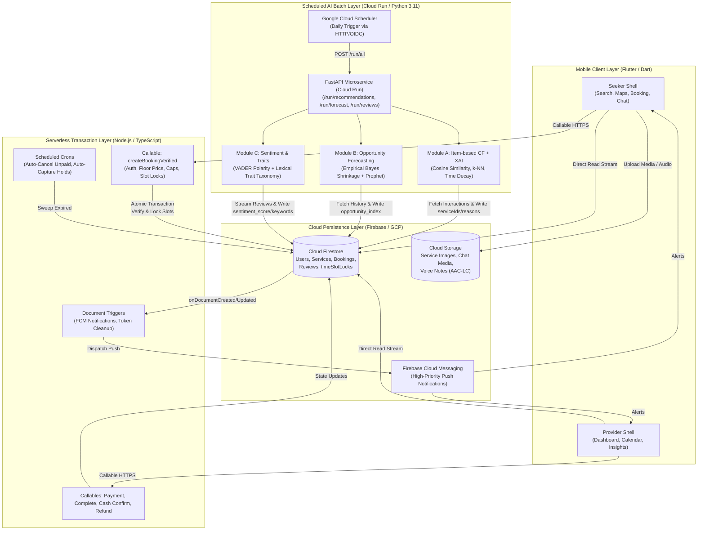

# KLServeLink — On-Demand Service Marketplace & Scheduled AI Platform

[](https://flutter.dev)
[](https://dart.dev)
[](https://www.typescriptlang.org)
[](https://firebase.google.com/docs/functions)
[](https://firebase.google.com/docs/firestore)
[](https://www.python.org)
[](https://fastapi.tiangolo.com)
[](https://cloud.google.com/run)
[](https://www.docker.com)
[](https://facebook.github.io/prophet/)

> **Academic Project Notice:** This project was developed as an individual software engineering **Final Year Project (2025–2026)** at Tunku Abdul Rahman University of Management and Technology (TAR UMT). It represents a full-stack, distributed systems architecture designed and implemented across mobile, serverless backend, and cloud microservices.

---

## 📌 Executive Summary

**KLServeLink** is a comprehensive, production-modeled on-demand service marketplace connecting service seekers with localized service providers across the Klang Valley (Kuala Lumpur & Selangor, Malaysia). The platform resolves critical challenges inherent in traditional service platforms—specifically client-side pricing tampering, booking concurrency collisions (double-booking), opaque recommendations, and demand uncertainty for freelance providers.

### High-Impact Engineering Highlights:
* **Zero-Trust, Server-Authoritative Dynamic Pricing:** TypeScript Firebase Cloud Functions re-evaluate pricing rules, distance formulas (Haversine), time windows, and priority-based exclusive groups on the server, strictly overriding client-submitted totals.
* **Concurrency-Safe Distributed Time-Slot Locking:** 5-minute granular document locks (`timeSlotLocks/${providerId}_${dayKey}/slots/${slotId}`) managed within atomic Firestore transactions guarantee zero double-booking under concurrent reservation attempts.
* **Decoupled Scheduled AI Batch Microservice:** A containerized Python 3.11 / FastAPI service running on Google Cloud Run executes scheduled batch jobs triggered by Cloud Scheduler to precompute recommendation matrices, demand forecasts, and review analytics into Firestore without incurring mobile client overhead or blocking transactional cloud functions.
* **Explainable AI (XAI) & Cold-Start Recommender:** Item-based Collaborative Filtering ($k=40$) with half-life time decay paired with a 4-tier cold-start fallback (views $\rightarrow$ recent searches $\rightarrow$ 8km/20km geo-filtering $\rightarrow$ popularity) and transparent, human-readable justification reasons shown in-app.
* **Empirical Bayes Demand Forecasting:** Provider hourly booking models blended with marketplace demand using shrinkage ($w = n / [n + 15]$) and additive weekly/daily Prophet seasonality, surfacing *"High-Opportunity Hours"* directly to provider dashboards.
* **Multi-Navigator Dual-Role Mobile Client:** An Android-oriented Flutter application featuring dual Seeker and Provider shells, where the Provider shell orchestrates 6 independent `Navigator` stacks via custom `NavigatorObserver` instances to preserve tab navigation histories.

---

## 🏛️ System Architecture & Data Flow

KLServeLink employs a decoupled, event-driven serverless architecture designed to separate high-frequency client interactions from transactional business rules and compute-heavy statistical workloads.



---

## 📱 Visual Walkthrough & Portfolio Gallery

The interface was designed from the ground up for ergonomic one-handed mobile utility, visual clarity, and responsiveness.

### Seeker Experience

| 1. Onboarding & Splash | 2. Home & Recommendations | 3. Explainable AI (XAI) |
| :---: | :---: | :---: |
|  |  |  |
| *Hero splash introducing local on-demand service exploration in KL.* | *Horizontal carousel displaying personalized recommendations & categories.* | *Transparent breakdown explaining recommendation causes (CF, tags, geo).* |

| 4. Interactive Map Search | 5. Service Details Screen | 6. Booking & Slot Selection |
| :---: | :---: | :---: |
|  |  |  |
| *Google Maps SDK with custom markers, radius filters, and list view.* | *Detailed service specs, photo gallery, floor pricing, and reviews.* | *Interactive calendar & 5-minute interval scheduling with lock checks.* |

| 7. In-App E-Receipt (PDF) | 8. Multimedia Chat & Voice Notes |
| :---: | :---: |
|  |  |
| *Vector-generated PDF invoice preview via `pdf` and `printing` packages.* | *Real-time chat with photo sharing and in-app AAC-LC voice note recording/playback.* |

---

### Provider Business Suite

| 9. Business Dashboard | 10. Dynamic Pricing Editor | 11. AI Opportunity Forecast | 12. Review Analytics & Traits |
| :---: | :---: | :---: | :---: |
|  |  |  |  |
| *Executive KPI metrics: Total Bookings, Completed Jobs, and Revenue trends.* | *Rule builder: Day/time matchers, lead time, distance thresholds, priority caps.* | *7-day Prophet forecast highlighting High-Opportunity Hours and estimated RM.* | *Star distribution and canonical trait badges extracted via VADER NLP.* |

---

## ⚙️ Technical Deep Dives

### 1. Server-Authoritative Dynamic Pricing Engine
To prevent malicious tampering with booking amounts, all calculations occur on the server within `functions/src/pricing.ts` and `functions/src/index.ts`.

* **Base Floor & Billable Hours:** Services define an included duration ($h_{\text{inc}}$) and package base price ($P_{\text{base}}$). Additional hours beyond $h_{\text{inc}}$ are billed at an hourly rate ($R_{\text{hr}}$):
  $$\text{Base} = P_{\text{base}} + \max(0, h_{\text{total}} - h_{\text{inc}}) \times R_{\text{hr}}$$
* **Contextual Matching:** Rules match based on day-of-week (including overnight hour windows such as 22:00–06:00), Haversine spatial distance between seeker address and provider coordinates, minimum lead hours, and optional ISO date ranges.
* **Exclusive Group Conflict Resolution:** Rules belonging to the same `exclusiveGroup` (e.g. "time", "distance", "holiday") are sorted by priority and absolute value, ensuring only the dominant rule applies.
* **Configurable Boundary Caps:** Separate caps clamp percentage surcharges/discounts (`maxSurchargePercent`, `maxDiscountPercent`) and fixed amounts (`maxSurchargeFixed`, `maxDiscountFixed`), bounding final charges within defined min/max totals.

### 2. Distributed Double-Booking Prevention (Atomic Slot Locks)
To eliminate reservation collisions without requiring heavy relational locking systems:
1. When a booking request is validated, the server segments the duration into **5-minute discrete time chunks**.
2. For each chunk, a document reference is formed under:
   ```
   timeSlotLocks/${providerId}_${dayKey}/slots/${slotId}
   ```
   *(where `slotId` represents padded minutes since midnight, e.g. "0540" for 09:00 AM).*
3. Within an atomic `admin.firestore().runTransaction`, the function executes `tx.create(ref, ...)` for every slot reference.
4. If **any** single 5-minute slot document already exists, Firestore aborts the transaction immediately with `ALREADY_EXISTS`, guaranteeing strict mutual exclusion.
5. If a booking is cancelled or declined, Cloud Function triggers automatically batch-delete the corresponding slot lock documents.

### 3. Decoupled AI Batch Processing (Cloud Run & Python 3.11)
Scientific computing libraries require heavy system dependencies and C++ extensions (e.g. `cmdstan` for Bayesian modeling). Running these in mobile clients or serverless functions causes latency spikes and excessive cold starts. KLServeLink isolates these in a standalone Docker microservice (`klservelink_ai_batch/Dockerfile`):

* **Item-Based Collaborative Filtering (k-NN):**
  - Builds interaction matrices from bookings (weight 3.0) and service views (weight 0.25).
  - Applies exponential half-life time decay ($t_{1/2} = 30$ days) to de-weight historical events:
    $$w(t) = \exp\left(-\frac{\ln(2) \times \text{age\_days}}{30}\right)$$
  - Computes cosine similarity across services for $k=40$ nearest neighbors.
  - Generates top 3 human-readable explanation justifications (*"Because you booked / viewed X"*) stored directly in the recommendation document.
  - Multi-tier cold-start fallback ladder: Category views $\rightarrow$ Recent search terms $\rightarrow$ 8km/20km Haversine radius filter $\rightarrow$ Popularity & rating score.
* **Provider Demand Forecasting & Shrinkage:**
  - Aggregates historical bookings onto a continuous hourly grid.
  - Applies **Empirical Bayes Shrinkage** to balance sparse individual provider history ($n$) against aggregate marketplace demand patterns:
    $$w_{\text{provider}} = \frac{n}{n + 15}$$
  - For providers with sufficient data ($n \ge 20$), fits an additive **Prophet** model incorporating weekly and daily seasonalities.
  - Outputs `opportunity_index.slots` with expected booking probability and estimated RM revenue, classified into in-working-hours and out-of-working-hours opportunity sets.
* **Review Sentiment & Trait Taxonomy Pipeline:**
  - Analyzes service reviews by blending VADER compound polarity (70%) with 5-star normalized scores (30%).
  - Tokenizes review text into canonical service trait chips (*"Punctual"*, *"Professional"*, *"Affordable"*, *"Clean"*, *"Responsive"*), filtering generic filler stopwords and mapping multi-word phrases.

---

## 📂 Repository Directory Layout

```
fyp_flutter/
├── android/                         # Android native project files & Gradle configuration
├── assets/                          # App assets (images, onboarding graphics, category icons)
├── docs/
│   └── screenshots/                 # Curated, anonymized 720x1550 application showcase screenshots
├── functions/                       # Firebase Cloud Functions v2 (TypeScript)
│   ├── src/
│   │   ├── index.ts                 # Verified booking callables, triggers, crons & notifications
│   │   └── pricing.ts               # Server-side dynamic pricing calculation & rule engine
│   ├── package.json
│   └── tsconfig.json
├── klservelink_ai_batch/            # Containerized Python AI batch microservice (Cloud Run)
│   ├── app/
│   │   ├── main.py                  # FastAPI application & HTTP batch triggers
│   │   ├── recommend.py             # Item-based CF (k-NN), time decay, cold-start & XAI
│   │   ├── forecast.py              # Empirical Bayes shrinkage & Prophet demand forecasting
│   │   ├── arima_baseline.py        # Offline SARIMAX benchmark baseline
│   │   ├── reviews.py               # VADER sentiment analysis & trait keyword taxonomy
│   │   └── jobs.py                  # Batch orchestration pipelines
│   ├── tools/
│   │   └── evaluate_prophet_vs_arima.py # Automated MAE/RMSE/sMAPE/WAPE benchmark tool
│   ├── Dockerfile                   # Python 3.11-slim container with CmdStan compilation
│   └── requirements.txt
├── lib/                             # Flutter/Dart cross-platform application source
│   ├── app/                         # App shells, role routing (SeekerShell, ProviderShell)
│   ├── core/                        # Shared models, widgets, theme, and utility services
│   └── features/
│       ├── auth/                    # Auth gate, login, registration, role selection
│       ├── chat/                    # Real-time messaging, AAC-LC audio recorder & image viewer
│       ├── notifications/           # FCM messaging listener & local notifications handler
│       ├── pricing/                 # Dynamic pricing rules validator & provider editor UI
│       ├── provider/                # Provider dashboard, bookings calendar, profile, insights
│       ├── reviews/                 # Leave review form, rating aggregates, trait badges
│       ├── seeker/                  # Search, Google Maps, booking checkout, profile
│       └── user/                    # User models & Firestore data repositories
├── seed_tools/                      # Synthetic data generation and demo seeding tools
│   ├── seed_firestore.py            # Generates realistic users, bookings, and reviews
│   ├── seed_services.py             # Creates standardized category service documents
│   └── delete_seed.py               # Safely purges synthetic data via manifest tags
├── .env.example                     # Environment template for local microservice runs
├── analysis_options.yaml            # Dart static analysis configuration
├── firebase.json                    # Firebase deployment configuration
└── pubspec.yaml                     # Flutter package dependencies & asset manifests
```

---

## 🛠️ Local Development & Setup

### Prerequisites
* **Flutter SDK:** Version `3.9.0` or higher
* **Dart SDK:** Version `3.9.0` or higher
* **Node.js:** Version `20.x` or higher & npm
* **Python:** Version `3.11.x`
* **Docker:** Recommended for running the AI batch service locally
* **Firebase Account & CLI:** For Cloud Firestore and Cloud Functions emulation

### 1. Flutter Mobile Client Setup
```bash
# Clone the repository
git clone https://github.com/KAIYI7/fyp_flutter.git
cd fyp_flutter

# Install Dart/Flutter dependencies
flutter pub get

# Setup Firebase configuration
# Copy the example file and configure with your Firebase project credentials
cp lib/firebase_options.dart.example lib/firebase_options.dart
cp android/app/google-services.json.example android/app/google-services.json

# Run the Flutter application on Android
flutter run
```

### 2. Firebase Cloud Functions Setup
```bash
cd functions

# Install Node dependencies
npm install

# Build TypeScript to JavaScript
npm run build

# Emulate Cloud Functions locally
npm run serve
```

### 3. Python AI Batch Microservice Setup
#### Option A: Running with Docker (Recommended)
```bash
cd klservelink_ai_batch

# Build the container
docker build -t klservelink-ai .

# Run the container
docker run -p 8080:8080 \
  -e GOOGLE_APPLICATION_CREDENTIALS=/app/service-account.json \
  -v /path/to/service-account.json:/app/service-account.json:ro \
  klservelink-ai
```

#### Option B: Running Locally with Virtualenv
```bash
cd klservelink_ai_batch

python -m venv .venv
source .venv/bin/activate  # On Windows: .venv\Scripts\activate
pip install -r requirements.txt

# Install CmdStan (required for Prophet)
python -c "from cmdstanpy import install_cmdstan; install_cmdstan(cores=2)"

# Start the FastAPI server
uvicorn app.main:app --host 0.0.0.0 --port 8080 --reload
```

---

## 🧪 Quality Assurance & Evaluation Methodology

### Documented Module Functional Test Cases
During project development and evaluation, **115 distinct black-box module functional test cases** were designed, executed, and documented across 7 functional sub-systems:

| Test Module | Documented Cases | Core Focus & Verification Boundaries |
| :--- | :---: | :--- |
| **Search & Discovery** | 18 | Keyword matching, category filtering, radius bounding, sorting |
| **Dynamic Pricing** | 12 | Exclusive group resolution, cap clamping, lead-time checks, overnight time spans |
| **Demand Prediction** | 16 | History shrinkage calculation, Prophet fit convergence, fallback triggers |
| **Feedback & Sentiment** | 11 | VADER polarity score blending, trait extraction, stopword filtering |
| **Booking & Messaging** | 28 | 5-minute atomic slot locks, status lifecycle transitions, dispute resolutions |
| **Location & Maps** | 10 | Haversine distance accuracy, GPS fallback, camera target updates |
| **Auth & User Management**| 20 | Role routing, session persistence, profile creation, unauthorized write guards |
| **Total Test Cases** | **115** | Documented functional matrix covering positive, negative, and edge-case paths |

### Offline Time-Series Model Benchmarking
To scientifically evaluate time-series forecasting candidates, an automated comparative benchmark tool was engineered (`klservelink_ai_batch/tools/evaluate_prophet_vs_arima.py`).

The tool evaluates Prophet against a **SARIMAX $(1,0,1)(1,0,1)_{24}$** baseline across 4 statistical error metrics:
* **MAE (Mean Absolute Error):** Measures average magnitude of forecast errors.
* **RMSE (Root Mean Square Error):** Penalizes large deviations and extreme spikes.
* **sMAPE (Symmetric Mean Absolute Percentage Error):** Normalized percentage error bounded between 0% and 200%.
* **WAPE (Weighted Absolute Percentage Error):** Volume-weighted accuracy indicator avoiding division-by-zero on sparse hours.

*Evaluation Result:* In local service demand profiles characterized by strong weekly periodicity and intermittent sparsity, Prophet combined with empirical Bayes shrinkage demonstrated superior stability compared to autoregressive baselines, which suffered from variance instability on zero-booking intervals.

---

## ⚠️ Academic Pilot Scope & Limitations

To ensure engineering honesty and transparency:
1. **Academic Prototype Status:** KLServeLink was developed as an educational prototype for an academic Final Year Project. Formal commercial penetration testing, multi-region failover, and high-concurrency stress testing ($>10,000$ simultaneous active connections) were not conducted.
2. **Batch AI Freshness:** Predictions and collaborative filtering recommendations are computed asynchronously via scheduled batch runs; they do not update in sub-second real-time following an interaction.
3. **Target Metrics Disclaimer:** Initial proposal targets (e.g. 30% search reduction or 20% booking uplift) represented aspirational academic design objectives, not verified production telemetry across a commercial user base.
4. **Third-Party API Requirements:** Maps, reverse geocoding, and push notifications rely on Google Maps Platform and Firebase infrastructure; valid developer project credentials and appropriate API restrictions are required for full live operation.

---

## 📄 License & Intellectual Property

This project was developed for academic assessment by **Lee Kai Yi** (Bachelor of Software Engineering (Honours), TAR UMT, 2025–2026). All original source code is made available for portfolio demonstration, educational review, and personal evaluation.
